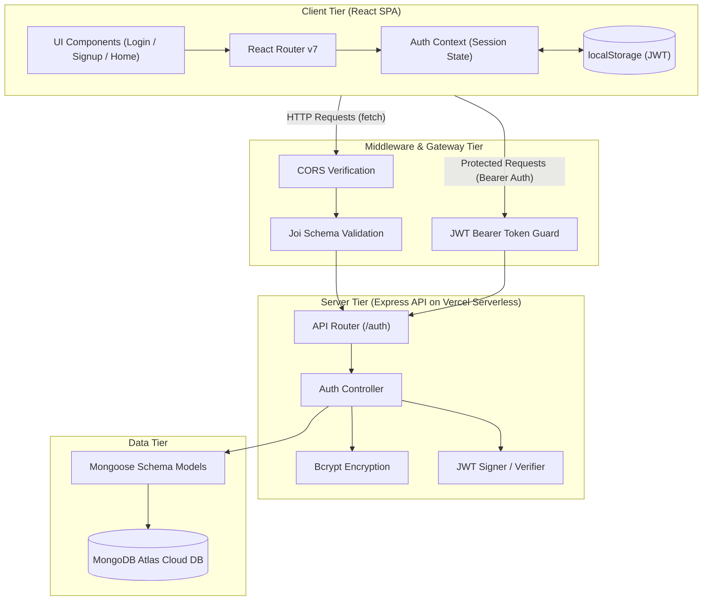

# 🔐 AuthSphere — Full-Stack MERN Authentication System

> A secure, production-ready full-stack authentication and session management web application built with the MERN stack.

[](https://log-in-signup-page-ui.vercel.app)
[](https://log-in-signup-page.vercel.app)
[](https://github.com/averagestudent123/LogIn-Signup_Page)

---

## 🌐 Live Demo

Experience the live deployed application:

- **Frontend Client:** [https://log-in-signup-page-ui.vercel.app](https://log-in-signup-page-ui.vercel.app)
- **Backend API Endpoint:** [https://log-in-signup-page.vercel.app](https://log-in-signup-page.vercel.app)

---

## 📖 Project Overview

Authentication and authorization are fundamental requirements for modern web applications. Implementing them insecurely risks credential leaks, session hijacking, and unauthorized resource access.

**AuthSphere** is a full-stack user authentication platform designed to provide a secure, seamless, and responsive login and registration experience. It handles client-side input validation, password salting and hashing on the server, stateless session management via JSON Web Tokens (JWT), and guarded private routes with automatic session restoration.

---

## ✨ Features

- **User Registration (Sign Up):** Validates user credentials on both frontend and backend before committing records to MongoDB Atlas.
- **Secure Authentication (Sign In):** Authenticates users via bcrypt-hashed password verification and issues cryptographically signed JWT tokens.
- **Show / Hide Password Toggle:** Interactive visibility switch embedded directly in password inputs for enhanced user convenience.
- **Route Guarding & Protection:** Private views (`/home`) are shielded by a `<ProtectedRoute />` wrapper; unauthenticated access redirects to `/login`.
- **Stateless Session Persistence:** Stores tokens in `localStorage` and automatically restores user identity through the `GET /auth/me` endpoint upon page reload.
- **Real-Time Toast Feedback:** Smooth, non-intrusive notifications for validation errors, failed attempts, and successful submissions using `react-toastify`.
- **Server-Side Input Sanitization:** Robust request validation powered by Joi schemas to protect endpoints against malformed payloads.
- **Modern Responsive Interface:** Clean card-style design crafted with Tailwind CSS v4, optimized across mobile, tablet, and desktop viewports.

---

## 🛠️ Tech Stack

### Frontend


- **React 19:** Functional component architecture leveraging React hooks (`useState`, `useEffect`, `useContext`).
- **Vite:** High-performance local development server and optimized build tool.
- **Tailwind CSS v4:** Modern utility-first styling with integrated `@tailwindcss/vite` plugin.
- **React Router DOM v7:** Client-side SPA route definitions and declarative redirects.
- **React Toastify:** Configurable in-app toast notification system.

### Backend


- **Node.js & Express.js:** Fast, flexible server framework configured for serverless execution.
- **MongoDB Atlas:** Managed multi-cloud document database.
- **Mongoose:** Object Data Modeling (ODM) providing schema enforcement, casting, and validation.

### Security & Utilities


- **JSON Web Token (JWT):** Generates and verifies signed bearer tokens with 24-hour expiration.
- **Bcrypt:** 10-round salted password hashing preventing plain-text credential leaks.
- **Joi:** Schema description and data validator preventing invalid input payloads.
- **CORS:** Configured cross-origin resource sharing supporting production deployment domains.

### Deployment & Tooling


- **Vercel:** Cloud platform hosting both frontend client and backend serverless API.

---

## 🏛️ System Architecture

The project implements a decoupled **Client-Server Architecture**:



---

## 📂 Project Structure

```text
LogIn-Signup_Page/
├── backend/
│   ├── Controller/
│   │   └── AuthController.js       # Signup and Login business logic
│   ├── Middleware/
│   │   ├── AuthMiddleware.js       # JWT verification middleware for protected routes
│   │   └── AuthValidation.js       # Joi request schema validation (signup/login)
│   ├── Model/
│   │   ├── User.js                 # Mongoose user schema definition
│   │   └── db.js                   # MongoDB connection lifecycle management
│   ├── Routes/
│   │   └── AuthRouter.js           # API route declarations (/signup, /login, /me)
│   ├── .env                        # Private environment variables (git-ignored)
│   ├── index.js                    # Express application entrypoint and middleware
│   ├── package.json
│   └── vercel.json                 # Vercel serverless deployment config for backend
│
├── frontend/
│   ├── src/
│   │   ├── components/
│   │   │   └── ProtectedRoute.jsx  # Route guard redirecting unauthenticated users
│   │   ├── context/
│   │   │   ├── AuthContext.jsx     # Context provider managing auth state
│   │   │   ├── AuthContextDef.js   # React Context instantiation
│   │   │   └── useAuth.js          # Custom hook to consume authentication context
│   │   ├── pages/
│   │   │   ├── Home.jsx            # Protected dashboard with user details
│   │   │   ├── Login.jsx           # Sign in view with password visibility toggle
│   │   │   └── Signup.jsx          # Registration view with input validation
│   │   ├── api.js                  # Centralized HTTP request helper functions
│   │   ├── App.jsx                 # Route configurations and layout wrapper
│   │   ├── main.jsx                # React root mount wrapped in AuthProvider
│   │   └── index.css               # Tailwind CSS imports and utility layer
│   ├── package.json
│   ├── vite.config.js              # Vite bundler configuration
│   └── vercel.json                 # SPA rewrite rules preventing 404 on page refresh
│
├── .gitignore                      # Git ignore rules for dependencies and secrets
└── README.md                       # Comprehensive project documentation
```

---

## ⚡ Installation & Local Setup

Follow these steps to run the project locally on your machine.

### Prerequisites

Ensure you have the following installed:
- [Node.js](https://nodejs.org/) (version 18.x or later)
- [npm](https://www.npmjs.com/) (bundled with Node.js)
- [Git](https://git-scm.com/)
- A free [MongoDB Atlas](https://www.mongodb.com/atlas) cluster account

---

### Step 1: Clone the Repository

```bash
git clone https://github.com/averagestudent123/LogIn-Signup_Page.git
cd LogIn-Signup_Page
```

---

### Step 2: Configure and Start the Backend

1. Navigate to the backend directory:
   ```bash
   cd backend
   ```

2. Install backend dependencies:
   ```bash
   npm install
   ```

3. Create a `.env` file in the `backend/` root directory:
   ```env
   PORT=3000
   MONGO_CONN=your_mongodb_connection_string
   JWT_SECRET=your_jwt_secret_key
   CLIENT_URL=http://localhost:5173
   ```

4. Start the backend development server:
   ```bash
   npm run dev
   ```
   *The server will start on `http://localhost:3000` and output `MongoDB connected` upon successful database handshake.*

---

### Step 3: Configure and Start the Frontend

1. Open a new terminal window and navigate to the frontend directory:
   ```bash
   cd frontend
   ```

2. Install frontend dependencies:
   ```bash
   npm install
   ```

3. *(Optional)* Create a `.env` file in the `frontend/` directory to override backend host:
   ```env
   VITE_BACKEND_URL=http://localhost:3000
   ```
   *(Defaults to `http://localhost:3000` automatically if omitted).*

4. Start the Vite development server:
   ```bash
   npm run dev
   ```

5. Open your browser and navigate to:
   ```text
   http://localhost:5173
   ```

---

## 🔐 Environment Variables

### Backend (`backend/.env`)

| Variable | Description | Example / Format |
| :--- | :--- | :--- |
| `PORT` | Local port where the Express server listens | `3000` |
| `MONGO_CONN` | MongoDB connection URI with credentials and database name | `mongodb+srv://<username>:<password>@cluster0.xxx.mongodb.net/<dbname>` |
| `JWT_SECRET` | Secret key used to sign and verify JSON Web Tokens | `your_secure_random_string_here` |
| `CLIENT_URL` | Allowed origin for CORS validation | `http://localhost:5173` (Local) / `https://your-frontend.vercel.app` (Prod) |

### Frontend (`frontend/.env`)

| Variable | Description | Example / Format |
| :--- | :--- | :--- |
| `VITE_BACKEND_URL` | Base URL of the backend API without trailing slash | `http://localhost:3000` (Local) / `https://log-in-signup-page.vercel.app` (Prod) |

> ⚠️ **Security Warning:** Never commit `.env` files or hardcode secrets into version control. Ensure all `.env` files are included in `.gitignore`.

---

## 📡 API Documentation

**Base API URL:** `https://log-in-signup-page.vercel.app/auth`

### Endpoints Overview

| Method | Endpoint | Description | Auth Required |
| :---: | :--- | :--- | :---: |
| `POST` | `/auth/signup` | Register a new user | ❌ No |
| `POST` | `/auth/login` | Authenticate existing user & issue token | ❌ No |
| `GET` | `/auth/me` | Fetch authenticated user profile | ✅ Yes (Bearer Token) |

---

### 1. Register User

- **URL:** `/auth/signup`
- **Method:** `POST`
- **Headers:** `Content-Type: application/json`
- **Request Body:**
  ```json
  {
    "name": "Jane Doe",
    "email": "jane@example.com",
    "password": "securePassword123"
  }
  ```
- **Validation Rules (Joi):**
  - `name`: string, min 3 characters, required
  - `email`: valid email format, required
  - `password`: string, min 6 characters, required
- **Success Response (`201 Created`):**
  ```json
  {
    "message": "User created successfully",
    "success": true
  }
  ```
- **Error Responses:**
  - `400 Bad Request`: `{ "error": "\"name\" length must be at least 3 characters long" }`
  - `409 Conflict`: `{ "message": "User already exists,please Login", "success": false }`
  - `500 Internal Server Error`: `{ "message": "Internal server error", "success": false }`

---

### 2. User Login

- **URL:** `/auth/login`
- **Method:** `POST`
- **Headers:** `Content-Type: application/json`
- **Request Body:**
  ```json
  {
    "email": "jane@example.com",
    "password": "securePassword123"
  }
  ```
- **Success Response (`200 OK`):**
  ```json
  {
    "message": "Login successful",
    "success": true,
    "token": "eyJhbGciOiJIUzI1NiIsInR5cCI6IkpXVCJ9..."
  }
  ```
- **Error Responses:**
  - `400 Bad Request`: Validation failure on input shape
  - `401 Unauthorized`: `{ "message": "Invalid email or password", "success": false }`
  - `500 Internal Server Error`: `{ "message": "Internal server error", "success": false }`

---

### 3. Get User Profile (Protected)

- **URL:** `/auth/me`
- **Method:** `GET`
- **Headers:** 
  `Authorization: Bearer <your_jwt_token>`
- **Success Response (`200 OK`):**
  ```json
  {
    "success": true,
    "user": {
      "_id": "6723aa9e1c2b3a4f5d6e7f8a",
      "name": "Jane Doe",
      "email": "jane@example.com"
    }
  }
  ```
- **Error Responses:**
  - `401 Unauthorized`: `{ "message": "Access denied. No token provided.", "success": false }`
  - `401 Unauthorized`: `{ "message": "Invalid or expired token.", "success": false }`
  - `404 Not Found`: `{ "message": "User not found", "success": false }`

---

## 🚀 Deployment Guide

This project is deployed to **Vercel** using a monorepo multi-project approach.

### 1. Backend Deployment (Vercel Serverless)

1. Connect your repository to Vercel and set the **Root Directory** to `backend`.
2. Configure **Environment Variables** in Vercel project settings:
   - `PORT`: `3000`
   - `MONGO_CONN`: Your MongoDB Atlas connection URI
   - `JWT_SECRET`: Secret key for signing tokens
   - `CLIENT_URL`: `https://log-in-signup-page-ui.vercel.app`
3. Whitelist `0.0.0.0/0` in MongoDB Atlas Network Access so dynamic serverless IP ranges can connect.
4. The backend uses `backend/vercel.json` to route incoming serverless requests through `@vercel/node`.

### 2. Frontend Deployment (Vercel SPA)

1. Create a second Vercel project and set the **Root Directory** to `frontend`.
2. Framework preset will automatically detect as **Vite**.
3. Configure **Environment Variable**:
   - `VITE_BACKEND_URL`: `https://log-in-signup-page.vercel.app`
4. The frontend includes `frontend/vercel.json` with rewrite rules (`/(.*) -> /`) to prevent 404 errors when reloading client-side React routes (`/login`, `/signup`, `/home`).

---

## 🔮 Future Improvements

- [ ] **Password Reset:** Add "Forgot Password" functionality via email-based OTP or timed magic link (Nodemailer / SendGrid).
- [ ] **OAuth2 Social Logins:** Integrate Google and GitHub Sign-In options.
- [ ] **Refresh Token Rotation:** Implement dual-token strategy (short-lived Access Token + HTTP-only cookie Refresh Token) for heightened session security.
- [ ] **Email Verification:** Require email confirmation prior to account activation.
- [ ] **Rate Limiting:** Protect `/auth/login` against brute-force attacks using `express-rate-limit`.
- [ ] **Unit & Integration Testing:** Introduce Jest/Supertest for API endpoints and Vitest/React Testing Library for frontend components.

---

## 👨‍💻 Author

**Mukul**

- GitHub: [@averagestudent123](https://github.com/averagestudent123)
- Project Repository: [LogIn-Signup_Page](https://github.com/averagestudent123/LogIn-Signup_Page)

---
